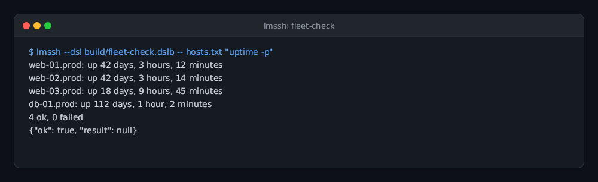
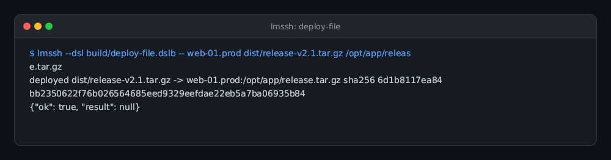
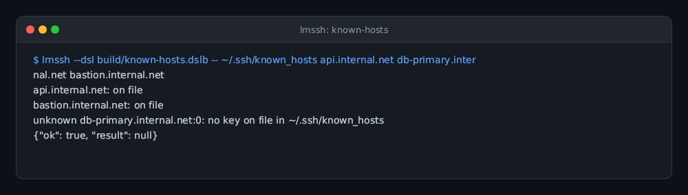
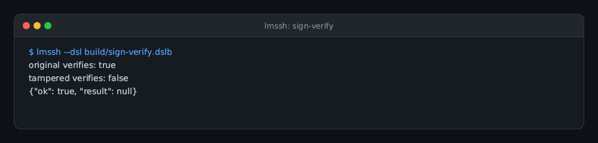
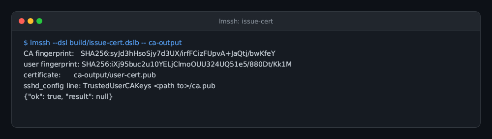
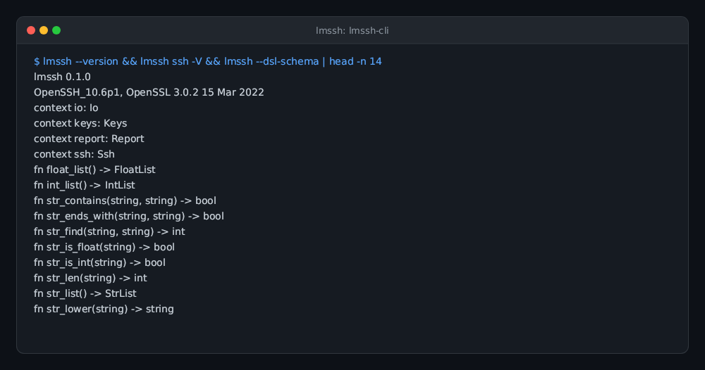

# lmssh

**lmssh is one static executable that carries OpenSSH's `ssh`, `sftp`, `scp` and `ssh-keygen` clients and lets scripts drive them.** It is built for automation: write an [lmscript](https://lmctl.com/tools/lmscript/skill.html) `_dsl_` block that runs commands on a fleet, moves files, rotates keys or signs artifacts, compile it to bytecode, and run it with `lmssh --dsl`. No OpenSSH installation, no libraries, nothing else to deploy.

[](https://github.com/lmctl-ai/lmssh/actions/workflows/ci.yml)
[](LICENSE)

It is **not a replacement for OpenSSH**. There is no server (`sshd`), no agent, and the scripting API does not mirror the command-line options. For interactive use the original programs are still there, with their original options, unchanged:

```sh
lmssh ssh -p 2222 -J bastion user@host      # the real ssh
lmssh sftp user@host                        # the real sftp
lmssh scp -r build/ user@host:/srv/app/     # the real scp
lmssh ssh-keygen -t ed25519 -f ~/.ssh/id    # the real ssh-keygen
```

Invoked through a symlink named `ssh`, `sftp`, `scp` or `ssh-keygen`, the executable behaves as that program. `sftp` and `scp` use the same executable as their `ssh` transport, and `ProxyJump` works the same way.

## A script

```
# fleet-check.lms — run a command on every host in parallel and report who failed
p = _dsl_ schema="schema/lmssh.dsl.json";
let hosts = str_list().add("web1").add("web2").add("db1");
ssh.parallel(16).timeout(60);
let results = ssh.each(hosts, "systemctl is-active nginx");
for (i in range(0, results.len())) {
  let r = results.at(i);
  if (!r.ok()) { report.add("down", r.dest(), r.status(), str_trim(r.stderr())); }
}
report.print();
report.fail_if_any();
end _dsl_
savedsl(p, "fleet-check.dslb");
```

```sh
lmscript fleet-check.lms            # compile against the schema (lmssh --dsl-schema --json prints it)
lmssh --dsl fleet-check.dslb        # run; exit 0 ok, 3 run/load error, 4 the script's own verdict
lmssh --dry-run --dsl fleet-check.dslb   # print every ssh/scp/sftp/ssh-keygen command, run none
lmssh --dsl job.dslb -- arg1 arg2   # script arguments, read with io.args()
```

The API covers sessions (`exec`, `output`, `put`, `get`, `put_dir`, `get_dir`, `cat`, `write`, `ls`, `exists`, `mkdir`, `rm`, `rename`, raw `sftp` batches), parallel fan-out over many hosts, jump hosts, connection reuse, timeouts, password and passphrase prompts, key generation, fingerprints, certificates, signatures, `known_hosts` maintenance, and a small `io` and `report` toolbox. See [durable-memory/04-api.md](durable-memory/04-api.md) for the reference and [examples/](examples/) for ready-to-run scripts.

## Gallery

| **Fleet execution** | **Atomic file deployment** | **Known hosts inventory** |
| --- | --- | --- |
|  |  |  |
| Parallel command execution across a server fleet with aggregate reporting.<br>`lmctl autorun https://raw.githubusercontent.com/lmctl-ai/lmssh/main/examples/fleet-check.lms` | SFTP upload, sha256 checksum verification, and atomic file replacement.<br>`lmctl autorun https://raw.githubusercontent.com/lmctl-ai/lmssh/main/examples/deploy-file.lms` | Query known_hosts inventory and detect unverified endpoints.<br>`lmctl autorun https://raw.githubusercontent.com/lmctl-ai/lmssh/main/examples/known-hosts.lms` |

| **Key signing & verification** | **CA & certificate issuance** | **lmssh CLI & Schema** |
| --- | --- | --- |
|  |  |  |
| Cryptographic file signing with SSH Ed25519 keys and tamper validation.<br>`lmctl autorun https://raw.githubusercontent.com/lmctl-ai/lmssh/main/examples/sign-verify.lms` | Generate Certificate Authority, user keys, and issue SSH certificates.<br>`lmctl autorun https://raw.githubusercontent.com/lmctl-ai/lmssh/main/examples/issue-cert.lms` | Embedded OpenSSH 10.6p1 suite and strongly typed DSL schema.<br>`lmssh --version && lmssh ssh -V` |

## How it works

The four OpenSSH client programs are compiled from a pinned `openssh-portable` tag with each `main()` renamed, and linked into one image together with OpenSSL's libcrypto, zlib and the [lmcode-cpp](https://github.com/lmctl-ai/lmcode-cpp) bytecode VM. A script step such as `session.exec(...)` forks a child, runs the real `ssh` code in it, and collects stdout, stderr and the exit status through pipes — so OpenSSH keeps its own behaviour (`exit()` calls, global state, `ssh_config`, `known_hosts`, multiplexing) and the script only sees results. Details: [durable-memory/](durable-memory/index.md).

## Install

Download the binary for your platform from the [releases page](https://github.com/lmctl-ai/lmssh/releases) and put it on your `PATH`:

| Asset | Notes |
| --- | --- |
| `lmssh-linux-x64`, `lmssh-linux-arm64` | fully static (musl); run on any Linux, including containers with no libc |
| `lmssh-macos-arm64`, `lmssh-macos-x64` | link only Apple system libraries |

Windows is not supported: OpenSSH-portable does not build there.

Build from source (needs cmake, a C/C++ toolchain, autoconf and automake, static OpenSSL and zlib):

```sh
scripts/sync-openssh.sh          # fetch the pinned OpenSSH source into third_party/
cmake -S . -B build -G Ninja && cmake --build build
./test.sh                        # 26 checks, including a throw-away sshd on 127.0.0.1
scripts/docker-build.sh          # the fully static musl build, in an Alpine container
```

## What it leaves out

No server, agent (`ssh-add`, `ssh-agent`), `ssh-keyscan`, PKCS#11 or FIDO/security-key support, GSSAPI/Kerberos, PAM, or libedit line editing in `sftp`. Password and passphrase answers are handed to OpenSSH through `SSH_ASKPASS`, and unknown host keys are never accepted unless the script says `strict_host_key("accept-new")` (or `"no"`).

## License

lmssh-authored code is MIT licensed; see [LICENSE](LICENSE). The bundled OpenSSH, OpenSSL, zlib and runtime libraries keep their own permissive licences: see [THIRD_PARTY_NOTICES](THIRD_PARTY_NOTICES), which carries the upstream notices that binary redistribution requires.

lmssh is a derived work of OpenSSH and is not affiliated with or endorsed by the OpenSSH project. Made by **Lattice Systems LLC**.
